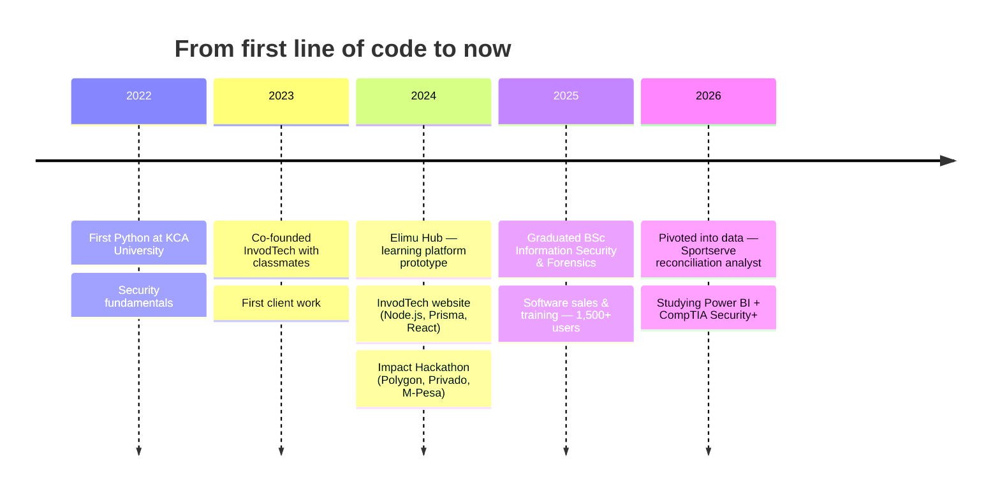

<b>🗺️ Software Journey</b>

 

<b>⭐ Featured work</b>

 

<table>
<tr>
<td align="center" width="50%">
<h3>Elimu Hub</h3>
Learning platform prototype built during university. Full-stack exercise in Node.js + Prisma.
  
<a href="https://github.com/EddMarwa/elimu-hub">View repo →</a>
</td>
<td align="center" width="50%">
<h3>InvodTech Website</h3>
Startup site built with classmates. First real client-facing project.
  
<a href="https://github.com/EddMarwa/invodtech">View repo →</a>
</td>
</tr>
</table>

<b>📊 GitHub stats</b>

 

  
  

  

  

